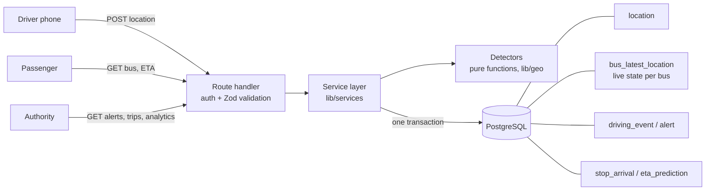

# Dhaka Bus Tracking API

A backend for tracking Dhaka's public buses: live bus positions and arrival times for passengers,
automatic detection of unsafe driving and illegal stops, and alerts and driver ratings for the
traffic authority.

**Backend only.** The interface is Swagger UI at `/docs`, plus scripts that simulate buses.

**Live demo**
- API docs (Swagger, try it out): https://traffic-management-psi.vercel.app/docs
- Health check: https://traffic-management-psi.vercel.app/api/v1/health
- Example: https://traffic-management-psi.vercel.app/api/v1/routes

**Demo accounts** (demo data only):

| Role | Email | Password |
|---|---|---|
| Driver (bus-1, has a rating) | `karim@demo.bus` | `driver-demo-123` |
| Driver | `rahim@demo.bus`, `salam@demo.bus` | `driver-demo-123` |
| Authority | `authority@demo.bus` | `authority-demo-123` |

In Swagger: open `POST /auth/login` → **Try it out** → pick the Driver or Authority example → **Execute**,
copy the `token`, click **Authorize** (top right) and paste it. Passenger endpoints need no login.
Run the full scenario against it: `API_URL=https://traffic-management-psi.vercel.app npm run demo`

---

## The problem

Dhaka's buses are hard to plan around:

- **Arrival times are unpredictable.** Passengers wait at stops with no idea when the next bus comes.
- **Buses stop anywhere.** Drivers stop mid-road to pick up passengers, which blocks traffic.
- **Driving is unsafe.** Speeding and harsh braking are common, and nobody measures them.

This project turns a GPS feed from each bus (for example, the driver's phone) into:

| For | What they get |
|---|---|
| **Passengers** (no login) | Routes, stops, live bus positions, ETA to any stop, driver first name and star rating |
| **Drivers** (login) | Start and end trips, send GPS, see their own trips, score and rating |
| **Traffic authority** (login) | All buses live, alerts (illegal stops, jams, severe speeding), trip events, driver ratings, ETA accuracy |

## Highlights

- **Driving events detected in real time:** harsh braking, speeding, unscheduled stops and traffic jams,
  in the same database transaction that saves each GPS point.
- **Fair to drivers:** a stop that lasts 3+ minutes is treated as a traffic jam, and its penalty is cancelled.
- **ETA that learns from history:** it uses past travel times for each stretch of road at that hour of day,
  then measures itself against real arrivals (`GET /analytics/eta-accuracy`).
- **Measured, not claimed:** on a laptop, one server process handled **300 buses + 300 passengers
  (~110 requests/s) with 0 errors and p95 under 200 ms** ([load test](docs/loadtest-results.md)).
- **Safe retries:** a phone that resends the same GPS point never creates duplicates.
- **Privacy by design:** passengers never see driver names, events or phone data; logs never contain
  tokens, passwords or exact driver locations.

---

## Architecture



Every GPS point runs this flow inside **one database transaction**:

1. Read and lock the trip row (two points from the same bus are handled one at a time).
2. Load the bus's previous state from `bus_latest_location` (one row, no history queries).
3. Insert the point; a unique index on `(busId, recordedAt)` turns retries into no-ops.
4. Run the detectors (plain functions: previous state + new point → events and alerts).
5. Save events and alerts, record any stop the bus just passed, update the live state and distance.

Either everything is saved or nothing is. A crash can never leave an event without its point.

### Folder map

| Folder | What lives there |
|---|---|
| `app/api/v1/` | Route handlers: one folder per URL, each a few lines (auth → validate → call a service) |
| `lib/services/` | Business logic: trips, location, alerts, ETA, scores, analytics, rate limit |
| `lib/geo/` | Pure logic with no database: Haversine distance, detectors, score and rating formulas, ETA math |
| `lib/config/thresholds.ts` | Every business rule number in one file |
| `prisma/` | Database schema, migrations, idempotent seed |
| `scripts/` | Demo, live and history simulators, load test |
| `tests/` | Unit tests (pure logic) and integration tests (real database) |
| `public/openapi.yaml` | Hand-written API spec, shown by Swagger UI at `/docs` |

---

## Tech choices: what, why, and what else was considered

| Area | Used | Why | Alternative considered | Why not (for now) |
|---|---|---|---|---|
| Framework | **Next.js route handlers** (App Router) | One project and one deploy on Vercel; route handlers are plain `Request → Response` functions | Express / NestJS on a server | Needs a separate host; more setup for an MVP |
| Language | **TypeScript (strict)** | Types shared from DB to API; catches mistakes before running | JavaScript | No type safety on a data-heavy domain |
| Database | **PostgreSQL** | Transactions, row locks, unique and partial indexes, reliable aggregates | MongoDB | The core flow needs multi-table transactions and constraints |
| ORM | **Prisma** | Typed queries, migrations, readable schema | Drizzle, raw SQL | Prisma is the most readable for reviewers; raw SQL is used only where needed (locks, aggregates) |
| Validation | **Zod** | One schema validates input and gives TypeScript types | Manual checks, Joi | More code, no shared types |
| Auth | **JWT (jose) + bcryptjs** | Stateless tokens work across serverless instances; `jose` runs on any runtime; `bcryptjs` needs no native build | Sessions in a DB, Auth.js | Extra table and lookups; Auth.js is aimed at browser logins |
| Distance | **Haversine in TypeScript** | Accurate enough within a city; no extension needed; easy to unit test | PostGIS | Better for spatial queries at scale; overkill for 6 stops |
| Live bus state | **`bus_latest_location` table** | One-row read for "where is bus X"; detector state (stopped since, speeding since) lives there too | Redis | Another service to run; Postgres is fast enough at this size |
| Rate limiting | **Counter table in Postgres** | Works across serverless instances (in-memory counters don't) | Upstash Redis | An extra paid or managed service |
| API docs | **Hand-written OpenAPI + Swagger UI** | Docs designed for readers, with rules and units in the descriptions | Generated from code | Generated docs miss the "why" and the business rules |
| Tests | **Vitest** | Fast, TypeScript out of the box | Jest | Slower setup with TypeScript and ESM |
| Hosting | **Vercel (Singapore) + Neon (Singapore)** | Free tiers, Git-based deploys, Neon is serverless Postgres with pooling; same region keeps DB calls fast | Render, Railway, AWS | More setup or cost for a demo |

## Key design decisions

| Decision | Chosen | Alternative | Why | When I'd change it |
|---|---|---|---|---|
| Where detection runs | Inside the location request, synchronously | A message queue + worker | Simple and consistent: the response already contains events | When one instance's CPU becomes the limit |
| Which clock decides | Phone time (`recordedAt`) for detection; server time for "is the bus still online?" | Server time for everything | Slow networks would otherwise create fake stops and speeding | If phones' clocks prove unreliable |
| Late or repeated GPS points | Repeats → 200, no change. Late points → stored, but ignored by detection | Reject them | Phones retry and send buffered points; both must be safe | — |
| Long stops | Stop ≥ 60 s away from a stoppage = −10. If it reaches 3 min it becomes a JAM and the penalty is cancelled | Always penalize | In Dhaka, long stops are usually traffic, not the driver's fault | When jams can be confirmed by other buses on the same road |
| Trip score | Saved at trip end; computed on read (marked provisional) while active | Always compute on read | Fast reads, stable history | — |
| Driver rating | Cached on the driver, updated in the same transaction that ends a trip | Compute every time | Passenger endpoints read it constantly | — |
| Abandoned trips | Checked on reads and by a cron endpoint | Cron only | Free cron plans run rarely; reads keep data correct anyway | — |
| Route direction | Each trip is `UP` or `DOWN`; `DOWN` = stops in reverse | One route per direction | Half the seed data, simpler admin | If directions use different roads |
| Passenger access | No login, rate limited per IP | Login for passengers | Lower barrier; nothing private is exposed | If abuse appears |
| Score model | Rule-based penalties (a deliberate "dummy" score) | Machine learning | No real data yet; rules are explainable | Once real labelled data exists |

## Business rules

All numbers live in [`lib/config/thresholds.ts`](lib/config/thresholds.ts).

| Rule | Condition | Effect |
|---|---|---|
| Harsh brake | Slowing ≥ 3 m/s² between points 1–10 s apart (max one per 30 s) | −5 |
| Speeding | > 60 km/h for ≥ 10 s (one event per episode) | −5, or −10 and a SEVERE alert if the max was > 80 km/h |
| Unscheduled stop | < 2 km/h for ≥ 60 s, more than 50 m from any stop on the route | −10 and an alert |
| Jam | < 5 km/h for ≥ 3 min, away from stops | Alert only; cancels the stop penalty |
| Trip score | 100 − penalties (never below 0) | Saved at trip end |
| Driver rating | Average of the last 30 completed trips (needs 5) | Stars = rating / 20 |
| Abandoned | No GPS for 10 min | Trip marked ABANDONED, excluded from rating |

**Example:** one harsh brake (−5), one speeding episode at 75 km/h (−5) and one illegal stop (−10)
give a trip score of **80**. If that stop had turned into a 3-minute jam, the score would be **90**.

> The scoring is a deliberately simple, rule-based model so every point lost can be explained.

## ETA: how it works and how it is measured

1. **Live ETA:** distance along the remaining stops ÷ the average speed of the last 5 GPS points (minimum 8 km/h).
2. **History-aware ETA:** when a bus passes a stop, the time is saved (`stop_arrival`). For each stretch
   (stop A → stop B), the ETA uses the average past travel time **at the same hour of day** (Dhaka time),
   if at least 3 past trips exist. Otherwise it falls back to live speed.
3. **Measured:** every ETA answer is logged (`eta_prediction`) and later compared with when the bus
   actually arrived. `GET /analytics/eta-accuracy` reports mean, median and p90 error and "within 2 minutes",
   split by how far ahead the prediction was. It also compares both methods **at the same moments**,
   using only data that existed at that time.

**Result on simulated traffic** (120 trips, 3 drivers, rush hours and bottlenecks; `npm run simulate:history -- --trips 120`),
comparing both methods on the same 2,368 moments:

| Predicting arrival… | Live-only mean error | History-aware mean error | Improvement |
|---|---|---|---|
| 0–5 min ahead | 53 s | 29 s | 45% |
| 5–15 min ahead | 183 s | 97 s | 47% |
| 15+ min ahead | 377 s | 270 s | 28% |
| **All** | **275 s** | **187 s** | **32%** |

ETAs within 2 minutes of the real arrival rose from 40% to 51%.

> These numbers come from a simulation, not real buses. With real GPS data the same endpoint
> measures real accuracy without any code changes.

## Performance

One `next start` process on a laptop (i7-1360P) with local PostgreSQL:

| Load | Requests/s | p95 latency | Errors |
|---|---|---|---|
| 300 buses (GPS every 5 s) + 300 passengers (ETA every 5 s) | ~110 | 175 ms (GPS), 193 ms (ETA) | 0 |
| 500 + 500 | saturated at ~110 | seconds | — |

The limit is one Node process's CPU. More instances scale it out (Vercel does this automatically).
Details and the fixes made along the way: [docs/loadtest-results.md](docs/loadtest-results.md).

---

## API overview

Full details, examples and every error response are in Swagger UI at **`/docs`**.
All paths start with `/api/v1`. Errors always look like `{ "error": { "code": "...", "message": "..." } }`.

| Role | Endpoints |
|---|---|
| Auth | `POST /auth/login` |
| Passenger | `GET /routes`, `GET /routes/{id}/stoppages`, `GET /routes/{id}/buses`, `GET /buses/{id}`, `GET /buses/{id}/eta?stoppageId=` |
| Driver | `POST /trips`, `POST /trips/{id}/location`, `PATCH /trips/{id}/end`, `GET /drivers/me/trips/current`, `GET /drivers/me/trips`, `GET /drivers/me/rating` |
| Authority | `GET /buses`, `GET /alerts`, `PATCH /alerts/{id}`, `GET /trips/{id}`, `GET /trips/{id}/events`, `GET /drivers/{id}/rating`, `GET /drivers/{id}/trips`, `GET /analytics/eta-accuracy` |
| System | `GET /health`, `POST /internal/abandon-trips` (needs `x-cron-secret`) |

Demo accounts are listed at the top of this README.

---

## Run it locally

**Needs:** Node.js 22+, PostgreSQL 14+.

1. Create the database user and databases (asks for your `postgres` password):

   ```bash
   psql -U postgres -h localhost -f scripts/setup-local-db.sql
   ```

2. Install and configure:

   ```bash
   npm install
   cp .env.example .env
   ```

   Then set `JWT_SECRET` and `CRON_SECRET` in `.env` to long random values
   (`openssl rand -hex 32`).

3. Create the tables and demo data:

   ```bash
   npx prisma migrate deploy
   npm run db:seed
   ```

4. Start the app and open http://localhost:3000/docs:

   ```bash
   npm run build
   npm start
   ```

### Try it

| Command | What it does |
|---|---|
| `npm run demo` | One full trip in ~10 s: harsh brake, speeding, illegal stop, ETA, alerts, score, rating |
| `npm run demo -- --jam` | Same, but the stop turns into a jam and the penalty is cancelled |
| `npm run simulate` | 3 buses drive live at the same time: careful, aggressive, stuck in a jam (watch in `/docs`) |
| `npm run simulate:history -- --trips 120` | Builds weeks of past trips so the history ETA has data, then prints ETA accuracy |
| `npm run loadtest -- --buses 300 --passengers 300` | Load test (creates and removes temporary buses) |

The simulators use simulated Dhaka traffic: rush hours are slower, and Farmgate and Shahbag are
bottlenecks. Buses move in straight lines between stops.

## Tests

```bash
npm test
```

- **Unit:** distance, every detector (cooldowns, episodes, jam cancellation), distance filter, score,
  rating (5-trip minimum, 30-trip window), ETA (both directions, passed stops, history logic).
- **Integration** (real test database `bus_test`): full trip lifecycle, duplicates, late points, rate limit,
  role access (drivers can't read each other's data, passengers can't see alerts or driver details),
  arrival recording and the ETA accuracy endpoint.
- **CI** (GitHub Actions): lint, type check, tests with a Postgres service, build, OpenAPI lint.

## Known limitations

- GPS from a phone is noisy, and the phone reports its own speed and time.
- One city-wide speed limit (60 km/h).
- Passengers poll for updates; there is no real-time push yet.
- Buses are simulated; no real GPS hardware has been connected.
- The scoring is rule-based, not learned from data.
- No ticketing, and no frontend apart from Swagger UI.

Smaller design decisions are listed in [docs/decisions.md](docs/decisions.md).

## Future plan

**Near term:** live updates (Server-Sent Events), per-road speed limits, jams confirmed by several buses,
push or SMS alerts for authorities, a Bangla SMS endpoint for feature phones, hotspot analytics
(where and when unsafe driving happens).

**Later:** dedicated GPS hardware, PostGIS, accelerometer-based braking detection, a learned driving
score once real data exists, and company-level authority accounts.
